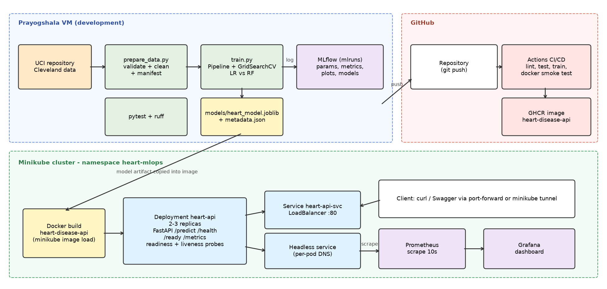

# Heart Disease Risk Prediction - End-to-End MLOps (AIMLCZG523 Assignment 01)

Binary classifier (heart disease present / absent) on the **UCI Heart Disease
(Cleveland) dataset**, delivered as a tracked, tested, containerised and
monitored API running on Kubernetes (Minikube).

> Educational project. The model is **not** a clinically validated diagnostic tool.

## Architecture



| Stage | Tooling | Entry point |
|---|---|---|
| Data acquisition + validation | urllib, pandas | `scripts/prepare_data.py` |
| EDA | matplotlib, seaborn | `scripts/run_eda.py` |
| Features + models | scikit-learn Pipeline (LR, RF), GridSearchCV | `src/heartml/features.py`, `src/heartml/train.py` |
| Experiment tracking | MLflow (file store `./mlruns`) | `python -m heartml.train`, `mlflow ui` |
| Packaging | joblib pipeline + `model_metadata.json` | `models/` |
| Tests + lint | pytest, ruff | `tests/`, `pyproject.toml` |
| CI/CD | GitHub Actions -> GHCR | `.github/workflows/ci.yml` |
| Serving | FastAPI + Uvicorn in Docker | `api/main.py`, `Dockerfile` |
| Deployment | Kubernetes manifests (Minikube) | `k8s/` |
| Monitoring | Prometheus + Grafana, JSON request logs | `monitoring/` |

## Quick start (clean machine, Python 3.12)

```bash
git clone https://github.com/2025ae05875-jeesh/mlops_assignment.git
cd mlops_assignment
python3 -m venv .venv && source .venv/bin/activate
pip install -r requirements.txt && pip install -e .
python scripts/prepare_data.py        # download + validate + clean
python scripts/run_eda.py             # figures -> reports/figures
python -m heartml.train               # tune LR + RF, MLflow, save champion
python scripts/predict_sample.py      # inference in a fresh process
pytest -v && ruff check .
```

## Run the API

```bash
uvicorn api.main:app --port 8000                     # local
docker build -t heart-disease-api:1.0.0 .            # container
docker run -d --name heart-api -p 8000:8000 heart-disease-api:1.0.0
bash scripts/smoke_test_api.sh http://localhost:8000
```

Example request (field codes follow the UCI documentation):

```bash
curl -X POST http://localhost:8000/predict -H "Content-Type: application/json" \
  -d '{"age":58,"sex":1,"cp":4,"trestbps":140,"chol":260,"fbs":0,"restecg":2,
       "thalach":130,"exang":1,"oldpeak":1.8,"slope":2,"ca":1,"thal":7}'
```

Response fields: `prediction` (0/1), `label`, `probability_disease`,
`confidence` (probability of the predicted class), `model_name`, `model_version`.
Invalid input returns **HTTP 422** with the offending field names.

| Endpoint | Purpose |
|---|---|
| `GET /health` | liveness |
| `GET /ready` | readiness (model loaded) |
| `GET /model-info` | served model metadata and metrics |
| `POST /predict` | prediction |
| `GET /metrics` | Prometheus metrics |
| `GET /docs` | Swagger UI |

## Kubernetes access (local - no public URL by design)

See `docs/RUNBOOK.md` Phase 6-7. Summary:

```bash
minikube start --driver=docker --cpus=2 --memory=4096
minikube image load heart-disease-api:1.0.0
kubectl apply -f k8s/
kubectl port-forward -n heart-mlops svc/heart-api-svc 8080:80   # http://localhost:8080/docs
```

Container image is also published by CI at
`ghcr.io/2025ae05875-jeesh/heart-disease-api:latest`.

## Data

UCI Machine Learning Repository, Heart Disease (id 45), file
`processed.cleveland.data`, DOI 10.24432/C52P4X. 303 rows, 13 features,
target `num` (0-4) binarised to 0 = no disease / 1 = disease. The download
URL, SHA-256 and quality report are recorded in `data/data_manifest.json`.

## Repository layout

```
api/                FastAPI service
src/heartml/        config, data, features, schema, train, predict
scripts/            prepare_data, run_eda, predict_sample, smoke test, traffic generator
tests/              pytest suite (hermetic, no network)
data/               raw + cleaned dataset, manifest
reports/            EDA figures, model plots, CV results, comparison table
models/             champion pipeline (joblib) + metadata
k8s/                namespace, configmap, deployment, services, ingress
monitoring/         Prometheus + Grafana manifests, dashboard JSON
.github/workflows/  CI/CD pipeline
docs/               runbook, design decisions, architecture, video checklist
screenshots/        evidence for the report
```
